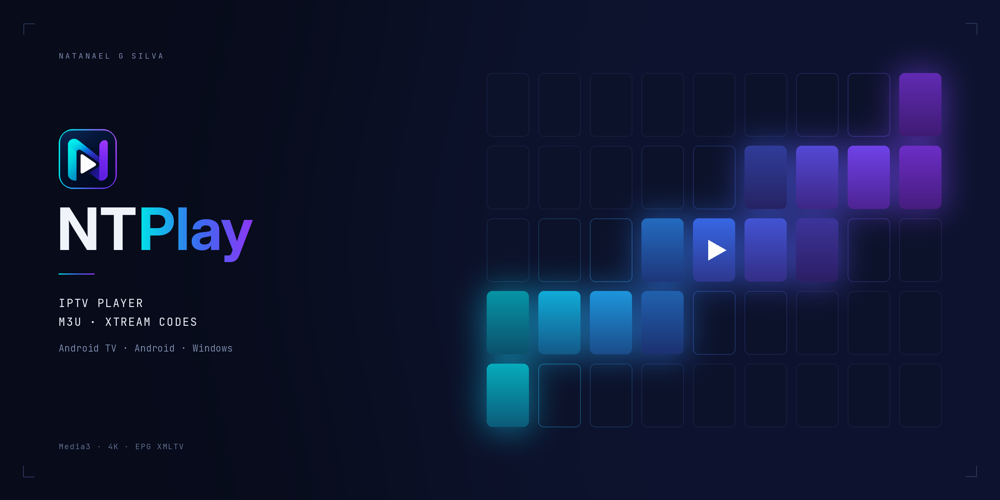
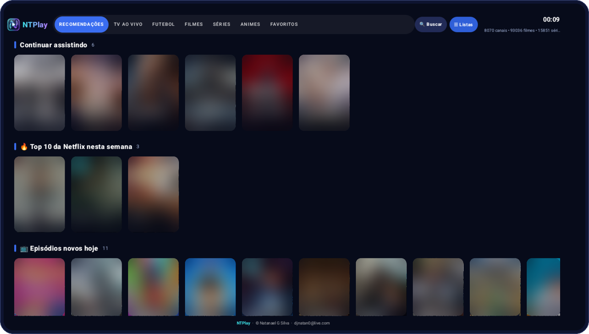
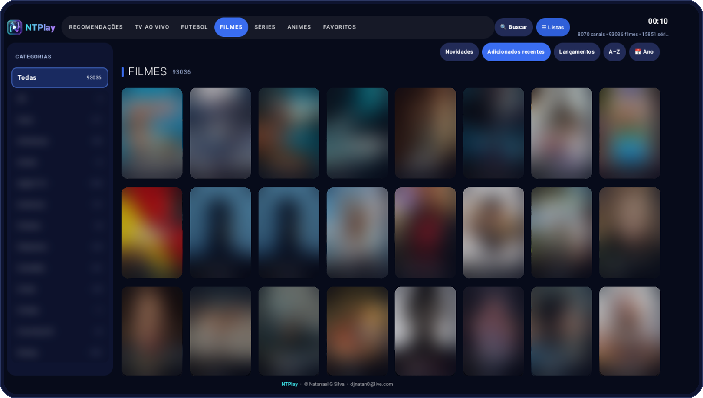
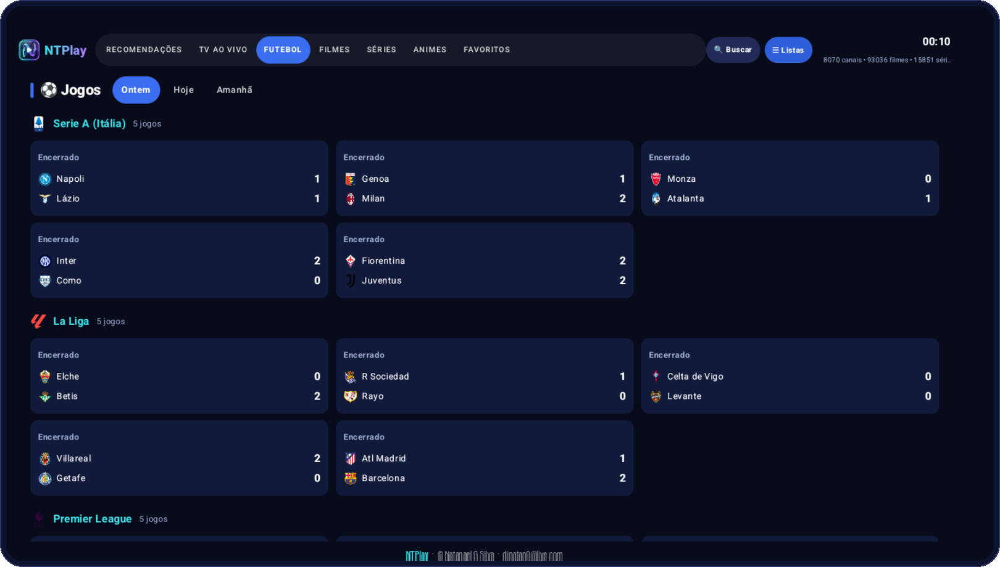
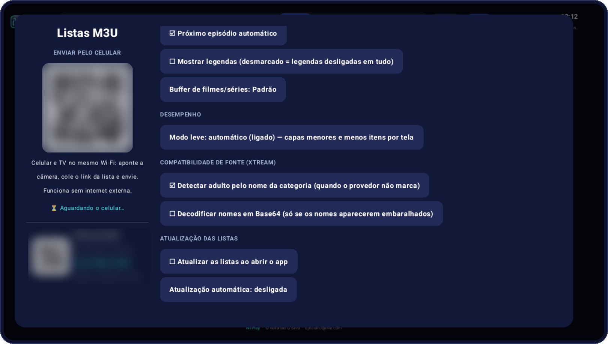

<p align="center">
  
</p>

<p align="center">
  <a href="https://github.com/NataNpg/NTPlay/releases/tag/tv-latest"></a>
  <a href="https://github.com/NataNpg/NTPlay/releases/tag/pc-latest"></a>
  <a href="https://github.com/NataNpg/NTPlay/releases"></a>
  
  <a href="LICENSE"></a>
</p>

<p align="center">
  <b>English</b> · <a href="README.pt-BR.md">Português (Brasil)</a>
</p>

---

**NTPlay** turns your M3U or Xtream Codes list into a streaming-style app: live TV, movies, series and anime with posters, synopses and a guide — on the TV, on the phone and on Windows. Built first for the remote control, with a native player tuned for 4K.

<p align="center">
  <a href="https://github.com/NataNpg/NTPlay/releases/download/tv-latest/NTPlay-TV.apk"></a>
  <a href="https://github.com/NataNpg/NTPlay/releases/download/mob-latest/NTPlay-Celular.apk"></a>
  <a href="https://github.com/NataNpg/NTPlay/releases/tag/pc-latest"></a>
</p>

## Screenshots

<p align="center">
  
</p>

<table>
  <tr>
    <td width="33%"><p align="center"><sub>Movies</sub></p></td>
    <td width="33%"><p align="center"><sub>Football</sub></p></td>
    <td width="33%"><p align="center"><sub>Settings</sub></p></td>
  </tr>
</table>

<sub>Posters and list details are blurred: NTPlay shows the content of the list you load and ships none of its own.</sub>

## Features

| | |
|---|---|
| 📺 **Streaming-style library** | Recommendations, Live TV, Football, Movies, Series, Anime and Favorites, with official posters, ratings and synopses. |
| 🔗 **Your lists, your way** | Several lists at once: M3U link, QR code or **Xtream Codes** (server, user and password). Optional automatic refresh every 6/12/24 h. |
| ▶️ **Native 4K player** | Media3/ExoPlayer with subtitle and audio track selection, AC3/EAC3/DTS audio, auto-reconnect and 4K display mode switching. |
| ⏭️ **Skip intro, next episode** | NTPlay remembers where each series' intro ends and offers to skip it; the next episode starts on its own. |
| 🗓️ **Live guide (EPG)** | Now/next on channel cards, full guide, channel list and picture adjustment inside the player. |
| ⚽ **Football today** | Today's matches and which channel in your list shows each one. |
| 🔎 **Smart search** | Movies, series, anime and live channels, tolerant to typos, with recent searches. |
| ⏯️ **Continue watching** | Picks up where you stopped, flags the **next** episode and **new** episodes since your last visit. |
| ☁️ **Encrypted cloud sync** | Lists, favorites, groups and progress synced between devices, encrypted on the device (AES-256-GCM). |
| 🪶 **Lite mode** | Automatic on low-memory TV boxes: smaller posters and lighter grids, so cheap devices stay smooth. |
| 🔄 **Auto-update** | The Android apps check for new versions and install them with one confirmation. |

## Platforms

| Platform | App | Download |
|---|---|---|
| **Android TV / Google TV / TV Box** | Native (Kotlin, Jetpack Compose, Media3) · **1.15.0** | [`NTPlay-TV.apk`](https://github.com/NataNpg/NTPlay/releases/download/tv-latest/NTPlay-TV.apk) |
| **Android phone** | Native (Kotlin, Jetpack Compose, Media3) | [`NTPlay-Celular.apk`](https://github.com/NataNpg/NTPlay/releases/download/mob-latest/NTPlay-Celular.apk) |
| **Windows** | Electron · **3.5** | [Installer and portable](https://github.com/NataNpg/NTPlay/releases/tag/pc-latest) |

Android requires 5.0 or newer.

## Access

NTPlay uses accounts: sign in with the user and password you received. Accounts are created by the administrator with a validity period, and the same account works on the TV, the phone and Windows. You get a warning in the app 7 days before it expires.

To get access, use the WhatsApp contact shown on the app's sign-in screen.

## Installation

**Android TV**
1. Allow installing apps from unknown sources for the app you will use (browser, file manager or a downloader app).
2. Download the APK from the link below, or copy it with a USB drive, *Send Files to TV* or `adb install NTPlay-TV.apk`:
   ```
   https://github.com/NataNpg/NTPlay/releases/download/tv-latest/NTPlay-TV.apk
   ```
3. NTPlay shows up on the TV home screen and is fully usable with the remote (arrows, OK, Back).

**Android phone:** download [`NTPlay-Celular.apk`](https://github.com/NataNpg/NTPlay/releases/download/mob-latest/NTPlay-Celular.apk) on the phone and open it.

**Windows:** download the installer (`NTPlay.Setup.*.exe`) or the portable version (`NTPlay.*.exe`) from the [release page](https://github.com/NataNpg/NTPlay/releases/tag/pc-latest).

> The app interface is in Portuguese.

## Build from source

Every Android build runs on GitHub Actions: changes under `tv-native/` publish `NTPlay-TV.apk` to the `tv-latest` release automatically.

Windows and web interface (Node.js):

```bash
npm install
npm run pc        # Electron window
npm run pc:build  # Windows installer and portable .exe
```

<details>
<summary><b>Repository layout</b></summary>

| Path | What it is |
|---|---|
| `tv-native/` | Android TV app (Kotlin, Compose, Media3) |
| `mobile-native/` | Android phone app (Kotlin, Compose, Media3) |
| `electron/`, `www/` | Windows app and its web interface |
| `supabase/` | Account and sync server (Edge Function) |
| `.github/workflows/` | Builds and releases for each platform |

</details>

## Disclaimer

NTPlay is only a player. It does not include or provide any channels, movies or series. Use only lists you have the right to access.

## License

[MIT](LICENSE) © Natanael G Silva
