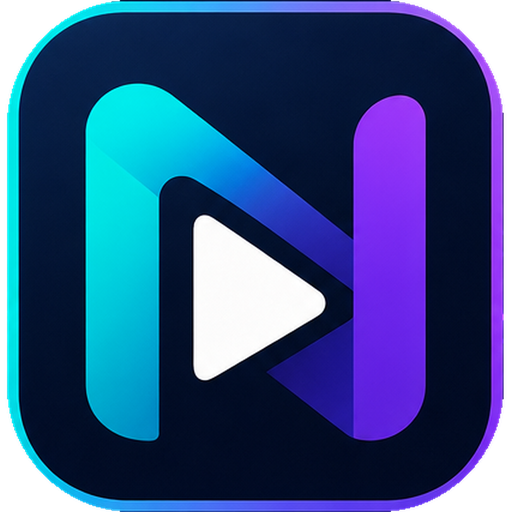

<p align="center"></p>

# NTPlay

Player de listas **M3U/IPTV** com visual de app de streaming: TV ao vivo, Filmes, Séries, Infantil, Animes, Favoritos e Recomendações. Um único código (`www/`) para **Windows, Android (celular), Android TV (controle remoto) e iOS**.

## Recursos
- Categorias na lateral esquerda (com contagem) e busca/lista M3U no topo
- Várias listas M3U ao mesmo tempo (marque "Usar"), salvas no aparelho
- Capas, banners, notas e **sinopse em português** buscadas na internet (TMDB opcional, Wikipédia, TVMaze, iTunes)
- Continua de onde parou e passa para o próximo episódio/filme automaticamente
- Favoritos, seletor de qualidade (4K), conteúdo adulto **oculto por padrão** (opção em Listas M3U › Preferências)
- Modo leve (automático em TV/celular) e navegação por setas/controle remoto
- Player nativo (ExoPlayer/AVPlayer) no Android, Android TV e iOS; VLC opcional no Windows

## Enviar lista pelo celular (QR code)
Em **Listas M3U** o app mostra um **QR code** e um link. Escaneie com o celular, cole o link da lista na página web (`enviar.html`) e ela chega no app sozinha (criptografada de ponta a ponta; usa o relay público ntfy.sh só para entregar a mensagem). Para isso funcionar:
1. Em **Settings › Pages**, escolha *GitHub Actions* como fonte; o workflow *Publicar página web* publica o app + `enviar.html`.
2. Os builds do Android/iOS/Windows já saem apontando para `https://SEU-USUARIO.github.io/NTPlay/`. Em builds locais, cole esse endereço no campo da janela Listas M3U.

Também dá para remover itens de **Continuar assistindo** um por um (botão ✕ no card; tecla Delete).

## Baixar
Vá em **Actions → Build NTPlay → Run workflow** (ou crie uma tag `v3.0.0`) e baixe os arquivos em *Artifacts*/*Releases*:

| Arquivo | Onde usar |
|---|---|
| `NTPlay-Android.apk` | Celular Android **e** Android TV |
| `NTPlay-iOS-unsigned.ipa` | iPhone/iPad (instalar com AltStore/Sideloadly, assina com seu Apple ID) |
| `NTPlay*.exe` | Windows (instalador e portátil) |

**Android TV:** copie o APK por pendrive/"Send Files to TV" ou `adb install NTPlay-Android.apk`. O app aparece na tela inicial da TV e é totalmente navegável pelo controle (setas, OK, Voltar).

## Rodar localmente
```bash
npm install
npm run web      # abre em http://localhost:8080 (navegador)
npm run pc       # janela Electron (Windows/Linux/Mac)
npm run android:init   # gera o projeto Android (precisa Android Studio/SDK)
npm run ios:init       # gera o projeto iOS (precisa macOS + Xcode)
```

## Lista padrão (opcional)
Copie `www/config.example.js` para `www/config.js` e preencha `NT_DEFAULT_M3U`. **Nunca** publique usuário/senha da sua lista (`config.js` já está no `.gitignore`).

## Aviso
O NTPlay é apenas um reprodutor: não inclui nem fornece canais, filmes ou séries. Use somente listas que você tem direito de acessar.

## Autor
Natanael G Silva — djnatan0@live.com · Licença MIT
