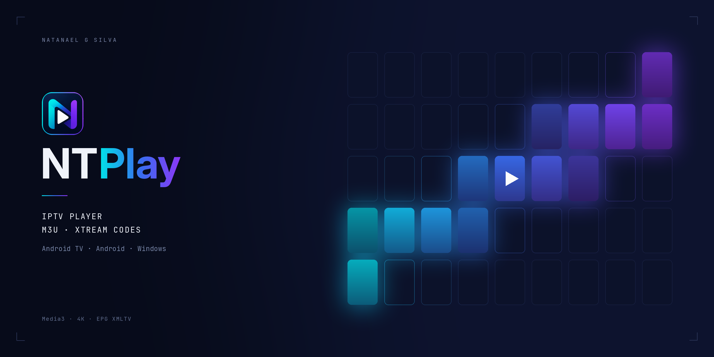

<p align="center">
  
</p>

<p align="center">
  <a href="https://github.com/NataNpg/NTPlay/releases/tag/tv-latest"></a>
  <a href="https://github.com/NataNpg/NTPlay/releases/tag/pc-latest"></a>
  <a href="https://github.com/NataNpg/NTPlay/releases"></a>
  
  <a href="LICENSE"></a>
</p>

<p align="center">
  <a href="README.md">English</a> · <b>Português (Brasil)</b>
</p>

---

O **NTPlay** transforma sua lista M3U ou Xtream Codes num app com cara de streaming: TV ao vivo, filmes, séries e animes com capas, sinopses e guia de programação — na TV, no celular e no Windows. Feito primeiro para o controle remoto, com player nativo ajustado para 4K.

<p align="center">
  <a href="https://github.com/NataNpg/NTPlay/releases/download/tv-latest/NTPlay-TV.apk"></a>
  <a href="https://github.com/NataNpg/NTPlay/releases/download/mob-latest/NTPlay-Celular.apk"></a>
  <a href="https://github.com/NataNpg/NTPlay/releases/tag/pc-latest"></a>
</p>

## Recursos

| | |
|---|---|
| 📺 **Biblioteca com cara de streaming** | Recomendações, TV ao vivo, Futebol, Filmes, Séries, Animes e Favoritos, com capas oficiais, notas e sinopses. |
| 🔗 **Suas listas do seu jeito** | Várias listas ao mesmo tempo: link M3U, QR code ou **Xtream Codes** (servidor, usuário e senha). Atualização automática a cada 6/12/24 h, se quiser. |
| ▶️ **Player nativo 4K** | Media3/ExoPlayer com escolha de legenda e áudio, som AC3/EAC3/DTS, reconexão automática e troca do modo de tela para 4K. |
| ⏭️ **Pular abertura e próximo episódio** | O NTPlay memoriza onde termina a abertura de cada série e oferece pular; o próximo episódio começa sozinho. |
| 🗓️ **Guia de programação (EPG)** | Agora/próximo nos cards dos canais, guia completo, lista de canais e ajuste de imagem dentro do player. |
| ⚽ **Futebol do dia** | Jogos de hoje e o canal da sua lista que passa cada um. |
| 🔎 **Busca esperta** | Filmes, séries, animes e canais ao vivo, tolera erro de digitação e guarda as últimas buscas. |
| ⏯️ **Continuar assistindo** | Volta de onde parou, marca o **próximo** episódio e os episódios **novos** desde a última vez. |
| ☁️ **Nuvem criptografada** | Listas, favoritos, grupos e progresso sincronizados entre aparelhos, criptografados no próprio aparelho (AES-256-GCM). |
| 🪶 **Modo leve** | Liga sozinho em TV Box com pouca memória: capas menores e grades mais leves, para aparelho simples rodar liso. |
| 🔄 **Atualização automática** | Os apps Android conferem se há versão nova e instalam com uma confirmação. |

## Plataformas

| Plataforma | App | Download |
|---|---|---|
| **Android TV / Google TV / TV Box** | Nativo (Kotlin, Jetpack Compose, Media3) · **1.15.0** | [`NTPlay-TV.apk`](https://github.com/NataNpg/NTPlay/releases/download/tv-latest/NTPlay-TV.apk) |
| **Celular Android** | Nativo (Kotlin, Jetpack Compose, Media3) | [`NTPlay-Celular.apk`](https://github.com/NataNpg/NTPlay/releases/download/mob-latest/NTPlay-Celular.apk) |
| **Windows** | Electron · **3.5** | [Instalador e portátil](https://github.com/NataNpg/NTPlay/releases/tag/pc-latest) |

No Android, precisa da versão 5.0 ou mais nova.

## Acesso

O NTPlay funciona com conta: entre com o usuário e a senha que você recebeu. As contas são criadas pelo administrador, com validade, e a mesma conta vale na TV, no celular e no Windows. O app avisa 7 dias antes de vencer.

Para ter acesso, chame no WhatsApp que aparece na tela de entrada do app.

## Instalação

**Android TV**
1. Permita instalar apps de fontes desconhecidas para o app que você vai usar (navegador, gerenciador de arquivos ou um app de download).
2. Baixe o APK pelo link abaixo, ou copie por pendrive, *Send Files to TV* ou `adb install NTPlay-TV.apk`:
   ```
   https://github.com/NataNpg/NTPlay/releases/download/tv-latest/NTPlay-TV.apk
   ```
3. O NTPlay aparece na tela inicial da TV e funciona inteiro pelo controle (setas, OK, Voltar).

**Celular Android:** baixe o [`NTPlay-Celular.apk`](https://github.com/NataNpg/NTPlay/releases/download/mob-latest/NTPlay-Celular.apk) no celular e abra.

**Windows:** baixe o instalador (`NTPlay.Setup.*.exe`) ou a versão portátil (`NTPlay.*.exe`) na [página da versão](https://github.com/NataNpg/NTPlay/releases/tag/pc-latest).

## Compilar a partir do código

Os apps Android são compilados no GitHub Actions: mudanças em `tv-native/` publicam o `NTPlay-TV.apk` na release `tv-latest` automaticamente.

Windows e interface web (Node.js):

```bash
npm install
npm run pc        # janela Electron
npm run pc:build  # instalador e .exe portátil do Windows
```

<details>
<summary><b>Estrutura do repositório</b></summary>

| Caminho | O que é |
|---|---|
| `tv-native/` | App da Android TV (Kotlin, Compose, Media3) |
| `mobile-native/` | App de celular Android (Kotlin, Compose, Media3) |
| `electron/`, `www/` | App do Windows e sua interface web |
| `supabase/` | Servidor de contas e sincronização (Edge Function) |
| `.github/workflows/` | Compilação e publicação de cada plataforma |

</details>

## Aviso

O NTPlay é apenas um reprodutor: não inclui nem fornece canais, filmes ou séries. Use somente listas que você tem direito de acessar.

## Licença

[MIT](LICENSE) © Natanael G Silva
